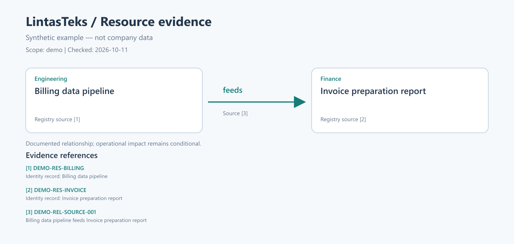

# Recorded offline resource demonstration

Date: 2026-10-11. Evidence label: **OFFLINE**.

- [request.json](request.json): explicit resolved input supplied to the component. The extraction fields were provided by the offline harness, not generated by Gemini.
- [resource-evidence.json](resource-evidence.json): actual deterministic `ResourceEvidenceLookup` output from the shipped synthetic catalog.
- [resource-map.json](resource-map.json): actual `EvidenceVisualSpec` output.
- [resource-map.svg](resource-map.svg): actual renderer output from that visual JSON.
- [resource-map.png](resource-map.png): raster preview of the SVG, visually inspected for card/arrow/reference placement.

No running Langflow server, Gemini, Astra, or IBM Bob was called. No generated final natural-language supervisor response is recorded here. This is not runtime evidence or a successful MCP submission screenshot. Source passages and relationships are authored synthetic demo data, not organizational facts.
